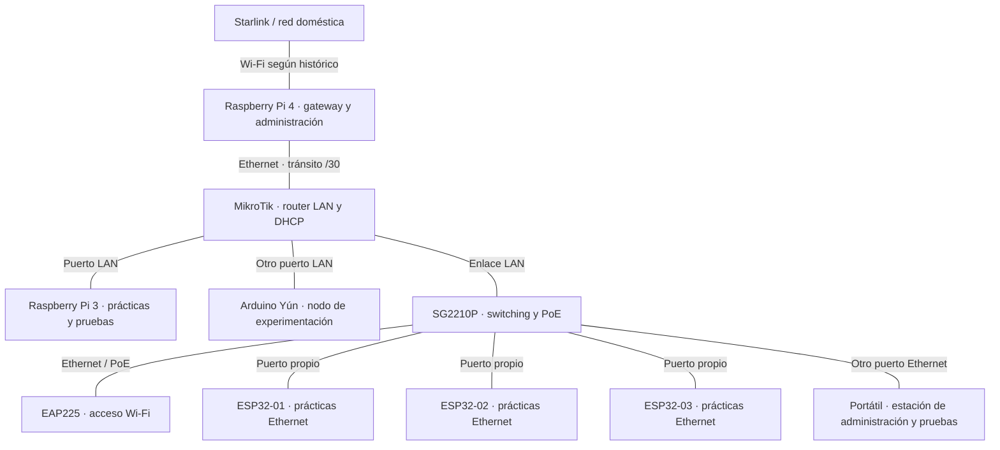

# Topología física — estado documental al 10/10/2026

**Alcance:** equipos y cables del laboratorio físico. La réplica Lenovo y las VMs del MEDION se describen por separado en [laboratorio virtual](../laboratorio-virtual/README.md).

**Fuentes:** CHANGELOG (22 y 27/09, 02–03/10 y seguimientos) y actualización comunicada por el usuario el 10/10/2026: Pi 3 para prácticas, portátil en otro puerto del switch y Yún en otro puerto LAN del MikroTik. Esta revisión no accede a equipos en vivo ni a NetBox.

## Conexiones documentadas

El esquema combina conexiones históricas con la actualización del usuario. No certifica números de puerto, direcciones ni disponibilidad actuales.

Las líneas representan enlaces, no direcciones de tráfico. El portátil no se identifica como Lenovo o MEDION sin evidencia. Los servicios de gestión no son equipos cableados adicionales.

## Mapa de conexiones y grado de evidencia

| Equipo / interfaz | Conectado a | Puerto documentado | Fuente y límite |
|---|---|---|---|
| Pi 4 Ethernet | MikroTik WAN | Pi 4 eth0 ↔ ether1 | CHANGELOG 21 y 27/09; vigencia pendiente |
| Pi 3 Ethernet | MikroTik LAN | ether2 en 27/09 | Usuario confirma relación actual; número actual no comprobado |
| Yún Ethernet | Otro puerto MikroTik LAN | ether3 en 20 y 27/09 | Usuario confirma relación actual; número actual no comprobado |
| SG2210P uplink | MikroTik LAN | Ambos extremos pendientes | Incorporación en CHANGELOG 02–03/10 |
| EAP225 | SG2210P | Pendiente | Ethernet/PoE según CHANGELOG 02–03/10 |
| ESP32-01 | SG2210P | Gi1/0/3 en 03/10 | Tabla MAC y reserva DHCP históricas |
| ESP32-02 | SG2210P | Gi1/0/5 en 03/10 | Tabla MAC y reserva DHCP históricas |
| ESP32-03 | SG2210P | Gi1/0/4 en 03/10 | Tabla MAC y reserva DHCP históricas |
| Portátil | Otro puerto SG2210P | Pendiente | Actualización del usuario 10/10; identidad/IP/interfaz sin confirmar |

No considerar libres ether4–ether5 por un registro de septiembre: el switch se añadió después. La conexión Wi-Fi doméstica de Pi 3 fue registrada históricamente; no se incluye como enlace vigente ni como gateway de respaldo implementado.

## Funciones

| Equipo | Responsabilidad |
|---|---|
| Raspberry Pi 4 | Gateway de salida y administración; NetBox/LibreNMS según histórico |
| MikroTik | Routing, DHCP y firewall de la LAN física |
| SG2210P | Switching y alimentación PoE de los equipos documentados |
| EAP225 | Acceso Wi-Fi del laboratorio |
| Raspberry Pi 3 | Prácticas, pruebas y diagnóstico de red; no duplica la gestión principal |
| Arduino Yún | Host Linux/microcontrolador para experimentación |
| Tres ESP32 | Hosts Ethernet para prácticas; funciones de diagnóstico permanentes pendientes |
| Portátil del switch | Estación de administración y pruebas; función concreta e identidad por confirmar |

## Datos no verificables desde el repositorio

- Identidad/modelo del portátil conectado al switch; no atribuirle automáticamente Omada ni virtualización.
- Puertos actuales de uplink MikroTik–SG2210P, AP, portátil y confirmación de puertos históricos de Pi 3/Yún/ESP32.
- IP/MAC, VLAN, rutas, concesiones DHCP, servicios y estado de enlaces actuales.
- Contenido vigente de NetBox y del HTML del dashboard: no hay exportación ni fuente HTML en esta rama.
- Estado real de la réplica Lenovo, segunda VM del MEDION y asociación de interfaces de OPNsense.

Para cerrar el mapa, correlacionar identificación física, puertos/enlaces, tabla MAC, DHCP/ARP y NetBox con fecha. No deducir el cableado únicamente de la lista de clientes de Omada.
