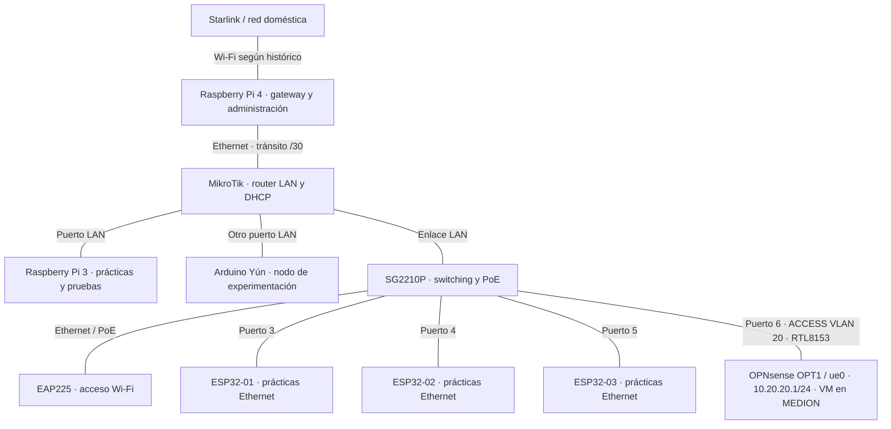

# Topología física — estado documental al 12/10/2026

**Alcance:** equipos y cables del laboratorio físico. La réplica Lenovo y las VMs del MEDION se describen por separado en [laboratorio virtual](../laboratorio-virtual/README.md).

**Fuentes:** CHANGELOG (22 y 27/09, 02–03/10 y seguimientos) y actualización comunicada por el usuario el 10/10/2026: Pi 3 para prácticas, portátil en otro puerto del switch y Yún en otro puerto LAN del MikroTik. Esta revisión no accede a equipos en vivo ni a NetBox.

## Conexiones documentadas

El esquema combina conexiones históricas con la actualización del usuario. No certifica números de puerto, direcciones ni disponibilidad actuales.

**Cambio 12/10:** puerto 6 Access VLAN 20 `LAB-FISICO` (`10.20.20.0/24`) dedicado a `OPT1/ue0` de OPNsense; esto no supone que los puertos 1–5 pertenezcan a VLAN 20. La nueva red no sustituye la LAN física MikroTik `192.168.88.0/24`, ni la LAN virtual `10.10.10.0/24`. DHCP de OPT1 y conectividad de clientes físicos pendientes de validar.

Las líneas representan enlaces, no direcciones de tráfico. El equipo del puerto 6 ha sido identificado por el usuario como MEDION netlab-ws01; la captura Omada confirma enlace a 1 Gbps. Los servicios de gestión no son equipos cableados adicionales.

## Mapa de conexiones y grado de evidencia

| Equipo / interfaz | Conectado a | Puerto documentado | Fuente y límite |
|---|---|---|---|
| Pi 4 Ethernet | MikroTik WAN | Pi 4 eth0 ↔ ether1 | CHANGELOG 21 y 27/09; vigencia pendiente |
| Pi 3 Ethernet | MikroTik LAN | ether2 en 27/09 | Usuario confirma relación actual; número actual no comprobado |
| Yún Ethernet | Otro puerto MikroTik LAN | ether3 en 20 y 27/09 | Usuario confirma relación actual; número actual no comprobado |
| SG2210P uplink | MikroTik LAN | Switch puerto 1; vecino LLDP MikroTik bridge/ether4 | Omada LLDP del 10/10; etiqueta de interfaz a contrastar en MikroTik |
| EAP225 | SG2210P | Switch puerto 2 | Omada LLDP del 10/10, vecino C0:3A:55:A9:6B:C2 |
| ESP32-01 | SG2210P | **Gi1/0/3**, referencia 12/10 | Cableado comunicado y enlace activo observado en Omada |
| ESP32-02 | SG2210P | **Gi1/0/4**, referencia 12/10 | Cableado corregido; enlace en puerto 4 visible en Omada; identificación MAC↔placa pendiente |
| ESP32-03 | SG2210P | **Gi1/0/5**, referencia 12/10 | Cableado corregido; enlace en puerto 5 visible en Omada; identificación MAC↔placa pendiente |
| MEDION netlab-ws01 | SG2210P, mediante adaptador USB/Ethernet | Switch puerto 6, enlace 1 Gbps | Informe 12/10: puerto 6 Access VLAN 20, MAC 00:E0:4C:68:31:B0, passthrough a OPNsense OPT1/ue0, 10.20.20.1/24, 1 Gbps; no hay cliente de VLAN 20 probado |

No considerar libres ether4–ether5 por un registro de septiembre: el switch se añadió después. La conexión Wi-Fi doméstica de Pi 3 fue registrada históricamente; no se incluye como enlace vigente ni como gateway de respaldo implementado.

## Cambios registrados el 12/10/2026

- MikroTik RB750r2: RouterOS y RouterBOOT 7.24.5 confirmados tras actualización; routing, DNS y DHCP comprobados dentro del alcance descrito en su [ficha](mikrotik/README.md).
- ESP32: funciones HTTP servidor (01), cliente (02), monitor (03) probadas.
- Cableado **corregido el 12/10**: ESP32-01→3, ESP32-02→4, ESP32-03→5. Esta es la referencia vigente; el 03/10 quedó registrado históricamente el cruce 02→5 / 03→4. Omada muestra enlaces activos en 3–5, pero falta correlación inequívoca MAC↔identidad de cada ESP32.

## Funciones

| Equipo | Responsabilidad |
|---|---|
| Raspberry Pi 4 | Gateway de salida y administración; NetBox/LibreNMS según histórico |
| MikroTik | Routing, DHCP y firewall de la LAN física |
| SG2210P | Switching y alimentación PoE de los equipos documentados |
| EAP225 | Acceso Wi-Fi del laboratorio |
| Raspberry Pi 3 | Prácticas, pruebas y diagnóstico de red; no duplica la gestión principal |
| Arduino Yún | Host Linux/microcontrolador para experimentación |
| Tres ESP32 | Servidor HTTP, cliente HTTP y monitor HTTP probados el 12/10; despliegue persistente pendiente |
| MEDION netlab-ws01 | Anfitrión de OPNsense y Debian; RTL8153 pasado a OPT1 para LAB-FISICO VLAN 20 por puerto 6 |

## Datos no verificables desde el repositorio

- MAC del adaptador MEDION: `00:E0:4C:68:31:B0`; el 10/10 se observó `ue0` sin IP; el 12/10 se configuró `OPT1/ue0` con `10.20.20.1/24`. La comunicación con un cliente y las políticas firewall siguen sin verificarse.
- Confirmación del extremo MikroTik del uplink, así como de los puertos históricos de Pi 3/Yún; para ESP32 se dispone de cableado comunicado (3, 4 y 5) y enlaces activos observados, pendiente de identificación MAC inequívoca de los nodos 02/03.
- IP/MAC, VLAN, rutas, concesiones DHCP, servicios y estado de enlaces actuales.
- Contenido vigente de NetBox y del HTML del dashboard: no hay exportación ni fuente HTML en esta rama.
- Estado real de la réplica Lenovo. En MEDION sí se verificaron `opnsense-lab` y `debian-client01`, con WAN `default` y LAN `lab-isolated`; consultar la ficha MEDION.

Para cerrar el mapa, correlacionar identificación física, puertos/enlaces, tabla MAC, DHCP/ARP y NetBox con fecha. No deducir el cableado únicamente de la lista de clientes de Omada.
