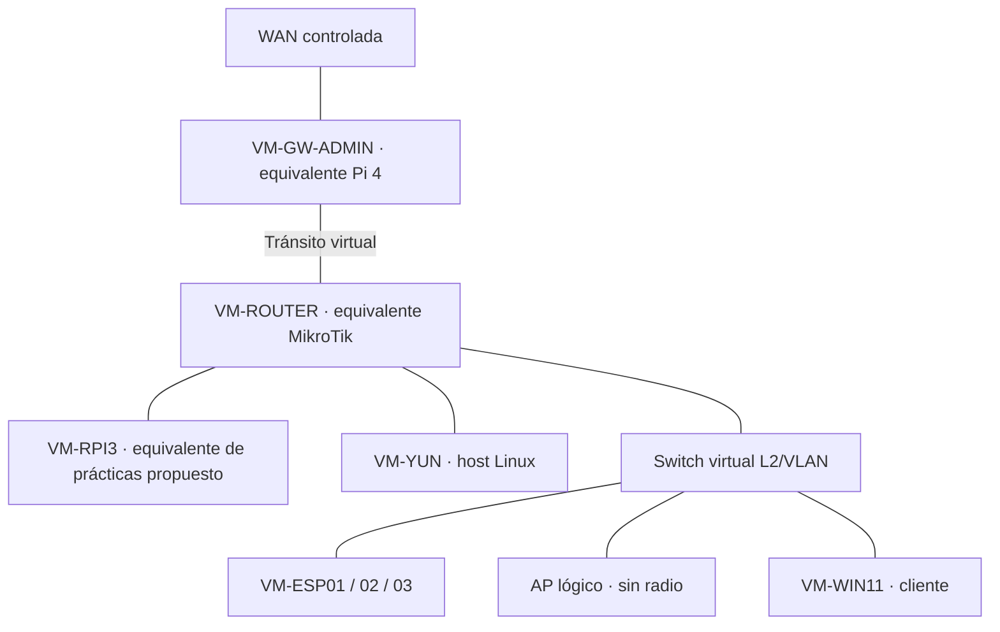

# Lenovo ThinkPad L13 Gen 3 — laboratorio virtual principal

**Fuente de diseño conservada:** `INFORME_ARQUITECTURA_LABORATORIO_VIRTUAL`, 10/10/2026, aportado por el usuario. El diseño es una **arquitectura objetivo**, no una implementación íntegra verificada.

## Objetivo

Reproducir **funcional y lógicamente** la topología física para experimentar y comparar pruebas sin modificar equipos reales.

**Propuesta de ajuste documental del 10/10/2026:** reflejar Pi 3 y Yún como ramas LAN del router, y los clientes del switch como ramas de este. VM-RPI3 se propone para representar la estación de prácticas; no consta aprobada ni creada. VM-WIN11 sigue siendo el cliente previsto en el informe: no se demuestra que corresponda al portátil físico añadido ni se presupone su sistema operativo.

El router y el switch virtual deben compartir el segmento LAN que se decida; los enlaces del esquema expresan el objetivo funcional, no interfaces ya asignadas.

**Diferencia de alcance:** ni PoE, ni radio/SSID reales, ni las funciones de microcontrolador ESP32/Yún se reproducen mediante una VM Linux genérica.

## Preparación verificada en el informe

| Elemento | Estado en fase documentada |
|---|---|
| Host | Linux Mint 22.3; KVM/QEMU y libvirt operativos |
| SSD externo | `LAB-VMS`, ext4 en `/mnt/lab-vms`, montaje persistente |
| Pool libvirt | `lab-vms` activo, autostart |
| Red `default` | NAT+DHCP, 192.168.122.0/24 |
| Red `LAB-NET` | Activa/autostart, `virbr50`, IP host 192.168.50.1/24; sin NAT ni DHCP declarados |
| VMs de réplica | Aún no creadas en la fase descrita |

La IP de `virbr50` hace que **LAB-NET no sea absolutamente aislada del host** por el simple hecho de no tener NAT. Su rol definitivo exige decisión.

## Componentes y decisiones pendientes

| Componente objetivo | Alternativa prevista | Estado |
|---|---|---|
| VM-GW-ADMIN | Linux, 2 NICs, administración | Diseñar y crear |
| VM-ROUTER | RouterOS CHR / Debian / OpenWrt | Elegir |
| Switch L2/VLAN | Linux bridge VLAN-aware / Open vSwitch | Elegir |
| VM-YUN | Linux ligero, rama LAN del router | Crear |
| VM-RPI3 | Linux ligero para prácticas | Propuesto el 10/10; decidir y dimensionar |
| VM-ESP01/02/03 | Tres Linux ligeros | Crear |
| AP virtual | Segmento lógico, sin radio real | Diseñar |
| VM-WIN11 | Windows 11 cliente gráfico | Crear |
| Redes/VLAN | WAN, tránsito, LAN, VLAN | Definir topología y direcciones |

**No reutilizar los rangos físicos si habrá rutas que solapen ambas redes.** La salida a Internet ha de ser explícita y controlada. No conectar bridges directamente a la LAN doméstica ni intervenir Docker, Tailscale o producción.

## Secuencia documental prevista

1. Verificar estado del host y XML de `LAB-NET`; decidir su destino.
2. Elegir router y switch virtual, topología WAN/tránsito/LAN y políticas.
3. Dimensionar CPU, RAM y discos, atendiendo a la RAM de 16 GB registrada en el informe.
4. Crear gateway y router; probar tránsito.
5. Crear switching L2/VLAN y hosts; medir ARP/ICMP/DHCP.
6. Crear Windows 11 y AP lógico; comparar prácticas con laboratorio físico.
7. No plantear integración híbrida hasta validar ambos entornos por separado.

**No ejecutado:** este documento solo corrige y conserva el diseño.

