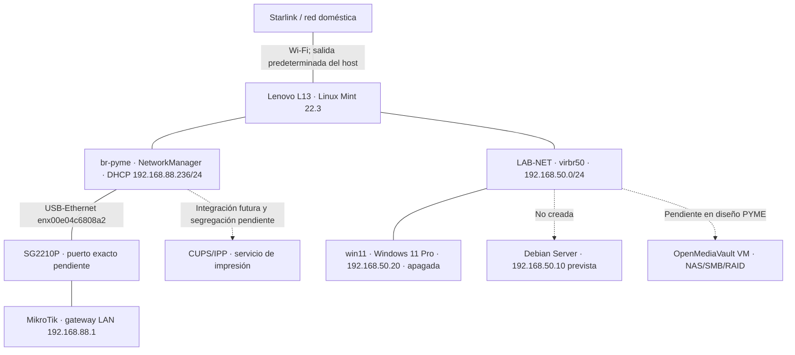

# Lenovo ThinkPad L13 Gen 3 — laboratorio virtual PYME

**Estado actualizado al 28/10/2026:** Windows 11 Pro instalado y probado sobre KVM/QEMU en `LAB-NET`; apagado al cierre. Debian Server pendiente. Bridge `br-pyme` físico separado; Omada migrado al VPS. El objetivo vigente es desplegar una **pequeña empresa virtual** en el Lenovo, utilizando KVM/QEMU, con conexión controlada al laboratorio físico. El proyecto anterior de replicar virtualmente Raspberry Pi 4, MikroTik, ESP32 y Arduino Yún quedó sustituido como plan activo el 15/10/2026.

> **Distinción fundamental:** el bridge Linux `br-pyme` del anfitrión **ya está creado y conectado al SG2210P**; **la VM `win11` ya existe, funciona y se conecta exclusivamente a `LAB-NET`**. No se ha conectado esta VM a `br-pyme` ni demostrado aislamiento integral IPv6/host.

## Arquitectura actual

Las flechas discontinuas representan **componentes pendientes**. Windows está realmente en `LAB-NET`, una red libvirt distinta de `br-pyme`; no hay prueba ni configuración declarada de conexión directa de Windows a la LAN física. La plataforma **MEDION `netlab-ws01` es independiente**: su adaptador RTL8153 y su VLAN 20 no deben confundirse con el Lenovo.

## Inventario de componentes y estado

| Componente | Función | Estado / evidencia |
|---|---|---|
| Lenovo L13, Linux Mint 22.3 | Anfitrión KVM/QEMU/libvirt | En servicio; sistema documentado |
| NetworkManager bridge `br-pyme` | Puente L2 de host hacia laboratorio físico | **Operativo**, DHCP `192.168.88.236/24` el 15/10; no es una red aislada |
| USB-Ethernet `enx00e04c6808a2` | Puerto físico subordinado a `br-pyme` | **Conectado** al SG2210P; puerto del switch **por identificar** |
| Wi-Fi `wlp0s20f3` | Salida habitual a Internet (Starlink) | `192.168.1.192/24`; única ruta default IPv4 por `192.168.1.1` tras corrección |
| Libvirt `default` | Red virtual preexistente | **Activa, autostart** (consulta 15/10); datos NAT/rango proceden de informes anteriores |
| Libvirt `LAB-NET` | Red virtual utilizada por Windows 11 | **Operativa y XML consultado el 28/10**: `virbr50`, `192.168.50.1/24` host, sin NAT/DHCP de libvirt ni interfaz física asociada |
| Windows 11 Pro, VM `win11` | Cliente de laboratorio | **Instalado y probado, apagado al cierre del 28/10**. IP `192.168.50.20/24` estática |
| OpenMediaVault VM | NAS, SMB y prácticas RAID | **Pendiente de crear** |
| Cuatro discos virtuales OMV | Prácticas secuenciales RAID 0/1/5/10 | **Previstos**, no son cuatro discos físicos |
| CUPS/IPP | Servidor de impresión de prácticas | **Pendiente**; decidir integración segregada de Docker existente |
| Omada Network Application | Administración SG2210P/EAP225 | **Migrado a VPS Hetzner `Ailab-core01`** y desinstalado del Lenovo (informe 28/10) |

**Máquinas virtuales:** el 15/10 no existían VMs, estado histórico superado. El 28/10 **`win11` está instalada y probada**, apagada; Debian Server no se ha creado. `LAB-NET` y `br-pyme` son redes distintas.

## Red física y configuración de `br-pyme` — verificado el 15/10

| Parámetro | Valor |
|---|---|
| Perfil NetworkManager | `br-pyme` |
| UUID | `20409153-bc7e-44e3-95e5-4fe172dae4fd` |
| Adaptador subordinado | `enx00e04c6808a2`, perfil `Conexión cableada 1` |
| IPv4 del bridge | `192.168.88.236/24` **por DHCP, no fija** |
| Gateway del laboratorio | MikroTik `192.168.88.1` (destino accesible; no ruta predeterminada del host) |
| Switch físico | TP-Link SG2210P; **número de puerto no verificado** |
| STP | Activado |
| VLAN filtering | Desactivado; **sin aislamiento VLAN adicional comprobado** |
| Ruta predeterminada IPv4 | **Solo** `via 192.168.1.1 dev wlp0s20f3` (Starlink) |

**Incidencia solucionada:** al activar el bridge apareció una ruta `default via 192.168.88.1 dev br-pyme metric 425`, preferida a Starlink (métrica 600). Aunque `ipv4.never-default yes` ya estaba configurado en el perfil, fue necesario `sudo nmcli device reapply br-pyme`. La consulta posterior mostró la única ruta predeterminada por Starlink. La interfaz física subordinada dejó de tener IPv4 propia: la dirección DHCP quedó en `br-pyme`.

**Prueba:** `ping -c 4 -I br-pyme 192.168.88.1`: **4 enviados / 4 recibidos / 0 % pérdidas**, RTT min/medio/máx `0,453 / 0,594 / 0,784 ms`. Esta prueba demuestra **conectividad del host** a MikroTik, **no** la futura conectividad VM→MikroTik, el aislamiento de las VMs ni persistencia del bridge tras reinicio.

## Recursos y almacenamiento

| Elemento | Situación y limitación |
|---|---|
| RAM del Lenovo | **16 GB** registrados en el informe de preparación; comprobar disponibilidad actual antes de crear VMs |
| Omada, medición **histórica** 15/10 | `tpeap.service` activo y consumo ~3,9 GB RAM / 234,1 MB swap antes de migración. **Ya no instalado en Lenovo** (informe 28/10) |
| SSD externo `/mnt/lab-vms` | **Montado y utilizado el 28/10**, `sda1` ext4 233,8 GB. Guarda `/mnt/lab-vms/win11.qcow2` (disco virtual 90 GiB). Estado actual del pool libvirt específico no aportado |
| Windows 11 | **4096 MiB asignados**; proceso QEMU observado con ~4,08 GiB de memoria residente durante ejecución |
| OpenMediaVault | Reserva orientativa ~1–2 GiB RAM; **no es consumo medido** |
| CUPS/IPP | Estimación ~100–200 MiB RAM; elección de despliegue pendiente |

Windows tiene ahora una asignación real de 4 GiB; las reservas OMV y CUPS siguen siendo **estimaciones**, no consumo medido. Dimensionar con mediciones actuales antes de instalar Debian u otros servicios. Dimensionar con medidas reales antes de instalar. La migración está **finalizada según informe 28/10**. No es posible calcular el ahorro exacto sin mediciones comparables. En el Lenovo se reportan **8,7 GiB disponibles** de 15 GiB totales y swap usada 1,7/2,0 GiB; la RAM disponible no es exclusiva para VMs.

## Funciones de la PYME por implementar

- **Windows 11:** cliente de dominio/red, herramientas TCP/IP, acceso SMB, pruebas DNS, impresión y administración.
- **OpenMediaVault:** NAS virtual, recursos compartidos SMB y prácticas separadas de RAID 0, 1, 5 y 10 con **cuatro discos virtuales**, sin atribuir redundancia física real al SSD del host.
- **CUPS/IPP:** servicio de impresión sin impresora física; si se usa Docker, mantener separadas sus redes de los contenedores existentes y habilitar solo conexiones explícitas.
- **Redes:** verificar DHCP, IPAM/NetBox, firewall, broadcasts, acceso a la red física y segmentación **antes** de conectar nuevas VMs al bridge. Como `br-pyme` ya comunica con la LAN del MikroTik, **no cumple por sí solo el antiguo requisito de red inicialmente aislada**.

Las direcciones `192.168.88.110` (Windows), `192.168.88.120` (OMV) y `192.168.88.130` (CUPS) se citaron únicamente como **propuestas históricas**: no son concesiones DHCP, reservas ni asignaciones aprobadas.

## Próximos trabajos — orden vigente

1. **Omada migrado, completado según informe del 28/10:** SG2210P y EAP225 conectados, controlador desinstalado del Lenovo. Detalles de backup, rollback y captura de tráfico no constan en el resumen.
2. **Memoria posterior a Omada:** 8,7 GiB disponible en medición anterior. **Última lectura el 28/10 con Windows apagado: 8,3 GiB disponible**, RAM total 15 GiB, usada 7,0 GiB, libre 6,3 GiB, swap 1,9/2,0 GiB. CPU y detalles de pool pendientes.
3. **Definir aislamiento de las VMs:** decidir si iniciar sobre una red libvirt realmente segregada y bajo qué condiciones permitir acceso al `br-pyme` que ya está conectado al SG2210P. Identificar puerto físico, configuración VLAN y DHCP/IPAM. No reutilizar Docker ni Tailscale por defecto.
4. **Completado: instalar Windows 11 Pro y validar conectividad IPv4 con host**. Pendiente auditoría integral de aislamiento y verificación de Secure Boot/TPM.
5. **Crear OpenMediaVault VM** y cuatro discos virtuales para practicar RAID/SMB, con medidas y resultados.
6. **Implementar CUPS/IPP** de forma segregada y probar impresión desde Windows.
7. **Validar tráfico y seguridad:** VM↔VM, VM↔gateway, DNS/DHCP, SMB, IPP, captura de paquetes, segmentación y políticas.
8. **Actualizar NetBox y CHANGELOG** con direcciones, conexiones, evidencias y decisiones verificadas.

## Diseño histórico sustituido — 10/10/2026

El informe `INFORME_ARQUITECTURA_LABORATORIO_VIRTUAL` proponía replicar **Pi 4 → MikroTik → switch → ESP32/Yún y Pi 3**, con VM-GW-ADMIN, VM-ROUTER, VM-RPI3, VM-YUN, VM-ESP01/02/03 y AP lógico. Aquel plan definía redes WAN/tránsito/LAN y conmutación virtual; **no llegó a desplegarse como conjunto de VMs**.

Se conserva como **antecedente de diseño**, no como inventario de componentes actuales, lista de tareas vigentes ni tabla de máquinas instaladas. El objetivo de PYME virtual lo sustituyó el **15/10/2026**; MEDION sigue siendo otra plataforma.

## Referencias

- [Topología física actual](../../laboratorio-fisico/topologia.md)
- [Redes libvirt: Lenovo y MEDION separados](../redes-libvirt/README.md)
- [Omada: migración finalizada](../../servicios/omada/README.md)
- [CHANGELOG](../../CHANGELOG.md) y [ROADMAP](../../ROADMAP.md)

## RAM posterior a la migración Omada — datos recibidos el 28/10

| Métrica | Valor |
|---|---|
| RAM total | 15 GiB |
| RAM utilizada | 6,6 GiB |
| RAM libre | 6,7 GiB |
| **RAM disponible** | **8,7 GiB** |
| Swap total | 2,0 GiB |
| Swap utilizada | 1,7 GiB |

**Nota:** la cifra disponible comprende memoria recuperable, varía con la carga y no debe dedicarse completamente a VMs. La cifra histórica del consumo de Omada no permite inferir ahorro exacto.

## Windows 11 Pro y LAB-NET — implementación 28/10/2026

**Evidencia:** informe operativo aportado el 28/10, no auditoría posterior en vivo. Esta sección prevalece sobre referencias anteriores a la VM como planificada.

| Elemento | Estado comprobado |
|---|---|
| VM | `win11`, Windows 11 Pro, creada y **apagada ordenadamente al cierre** |
| CPU / memoria | **4 vCPU / 4096 MiB RAM** |
| Almacenamiento | **90 GiB QCOW2** en `/mnt/lab-vms/win11.qcow2` |
| Firmware / TPM | UEFI/OVMF compatible con Secure Boot y **TPM 2.0 emulado**; activación efectiva de Secure Boot sin verificar |
| NIC / red | Intel `e1000e` en `LAB-NET` |
| IPv4 Windows | **`192.168.50.20/24` estática**, sin gateway ni DNS exterior |
| Usuario inicial | Cuenta local `netlab` |

**Preparación:** KVM/QEMU, libvirt, Virt-Manager, OVMF, `swtpm` y `swtpm-tools` comprobados; conexión `qemu:///system` operativa. SSD externo `sda1` ext4 de 233,8 GB montado en `/mnt/lab-vms` (`nvme0n1` interno ~238,5 GB). ISO de Windows situada en `/mnt/lab-vms/isos/Windows11_Client_x64_es-es_26300_9457.iso`, ~8,5 GB; SHA-256 registrado: `9828703784880421e6602504dfd99064e4cb739cc9b20aba22e3934372a14f9a` (huella de archivo, no validación de procedencia).

**Incidencias resueltas:** TPM virtual duplicado; CD-ROM dirigido a un directorio en vez de ISO; selección manual UEFI QEMU DVD-ROM; instalación sin acceso exterior mediante `start ms-cxh:localonly`; dirección APIPA por ausencia de DHCP; configuración estática IPv4 realizada con CMD elevado.

### Pruebas de red y límites

| Prueba | Resultado |
|---|---|
| Red `LAB-NET` / bridge | `192.168.50.0/24` / `virbr50` |
| IPv4 anfitrión | `192.168.50.1/24` |
| NAT / DHCP libvirt | **No configurados** según definición consultada |
| Enlace físico en definición libvirt | **Ninguno** |
| Windows → Lenovo | Ping a `192.168.50.1`: **4/4, 0 % pérdida** |
| Windows → Internet IPv4 | Ping a `8.8.8.8`: **0/4 respuestas** |
| Tabla de rutas | `route print -4` **sin ruta predeterminada** |

**Interpretación:** evidencia favorable al aislamiento IPv4 básico; **no se ha auditado completamente el aislamiento IPv6 ni las políticas de forwarding/firewall del anfitrión**. `br-pyme` sigue conectado a SG2210P, pero Windows usa la red virtual separada `LAB-NET`.

### Recursos, pendientes y siguiente fase

**Última lectura con `win11` apagada:** 15 GiB RAM total, 7,0 GiB usada, 6,3 GiB libre, **8,3 GiB disponible**; swap utilizada **1,9 de 2,0 GiB**. Durante la ejecución de Windows, el proceso `qemu-system-x86` llegó a ~4,08 GiB RSS. La lectura anterior de 8,7 GiB corresponde a otro momento tras desinstalar Omada.

**Debian Server aún no creada:** plan 2 GiB RAM, disco 40 GiB, IPv4 estática propuesta `192.168.50.10/24`. Próxima comprobación técnica, **en otro chat**, comprobar si existe ISO de Debian en `/mnt/lab-vms/isos`. Posteriormente: IPv6/aislamiento, Windows ↔ Debian, DHCP/DNS, pruebas de SMB e impresión. No se realizó ninguna de esas operaciones en esta actualización GitHub.
