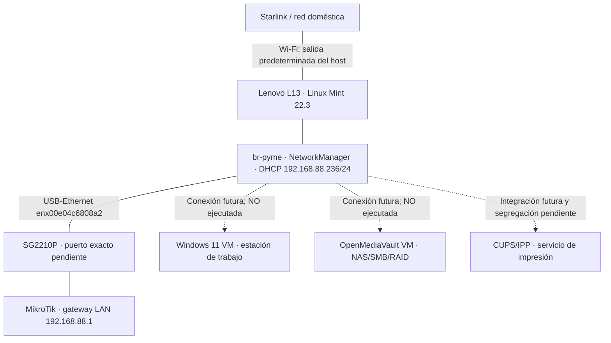

# Lenovo ThinkPad L13 Gen 3 — laboratorio virtual PYME

**Estado documental: 15/10/2026 (revisión 16/10).** El objetivo vigente es desplegar una **pequeña empresa virtual** en el Lenovo, utilizando KVM/QEMU, con conexión controlada al laboratorio físico. El proyecto anterior de replicar virtualmente Raspberry Pi 4, MikroTik, ESP32 y Arduino Yún quedó sustituido como plan activo el 15/10/2026.

> **Distinción fundamental:** el bridge Linux `br-pyme` del anfitrión **ya está creado y conectado al SG2210P**; **todavía no se ha creado ninguna VM**, por lo que no hay conectividad de clientes virtuales demostrada ni segmentación VLAN adicional acreditada.

## Arquitectura actual

Las flechas discontinuas representan **componentes pendientes**. El bridge y su enlace Ethernet son reales; el diagrama **no afirma** que ninguna VM o contenedor ya esté conectado. La plataforma **MEDION `netlab-ws01` es independiente**: su adaptador RTL8153 y su VLAN 20 no deben confundirse con el Lenovo.

## Inventario de componentes y estado

| Componente | Función | Estado / evidencia |
|---|---|---|
| Lenovo L13, Linux Mint 22.3 | Anfitrión KVM/QEMU/libvirt | En servicio; sistema documentado |
| NetworkManager bridge `br-pyme` | Puente L2 de host hacia laboratorio físico | **Operativo**, DHCP `192.168.88.236/24` el 15/10; no es una red aislada |
| USB-Ethernet `enx00e04c6808a2` | Puerto físico subordinado a `br-pyme` | **Conectado** al SG2210P; puerto del switch **por identificar** |
| Wi-Fi `wlp0s20f3` | Salida habitual a Internet (Starlink) | `192.168.1.192/24`; única ruta default IPv4 por `192.168.1.1` tras corrección |
| Libvirt `default` | Red virtual preexistente | **Activa, autostart** (consulta 15/10); datos NAT/rango proceden de informes anteriores |
| Libvirt `LAB-NET` | Red virtual preexistente, finalidad por decidir | **Activa, autostart** (consulta 15/10); `virbr50 / 192.168.50.1/24` según registro histórico, sin nueva validación de XML |
| Windows 11 VM | Puesto de trabajo de la PYME | **Pendiente de crear** |
| OpenMediaVault VM | NAS, SMB y prácticas RAID | **Pendiente de crear** |
| Cuatro discos virtuales OMV | Prácticas secuenciales RAID 0/1/5/10 | **Previstos**, no son cuatro discos físicos |
| CUPS/IPP | Servidor de impresión de prácticas | **Pendiente**; decidir integración segregada de Docker existente |
| Omada Network Application | Administración SG2210P/EAP225 | **Activo en Lenovo**; migración a VPS Hetzner pendiente |

**Máquinas virtuales:** `virsh list --all` no mostraba ninguna VM registrada en la comprobación del 15/10. No confundir redes libvirt existentes con VMs creadas ni con el bridge `br-pyme`, administrado por NetworkManager.

## Red física y configuración de `br-pyme` — verificado el 15/10

| Parámetro | Valor |
|---|---|
| Perfil NetworkManager | `br-pyme` |
| UUID | `20409153-bc7e-44e3-95e5-4fe172dae4fd` |
| Adaptador subordinado | `enx00e04c6808a2`, perfil `Conexión cableada 1` |
| IPv4 del bridge | `192.168.88.236/24` **por DHCP, no fija** |
| Gateway del laboratorio | MikroTik `192.168.88.1` (destino accesible; no ruta predeterminada del host) |
| Switch físico | TP-Link SG2210P; **número de puerto no verificado** |
| STP | Activado |
| VLAN filtering | Desactivado; **sin aislamiento VLAN adicional comprobado** |
| Ruta predeterminada IPv4 | **Solo** `via 192.168.1.1 dev wlp0s20f3` (Starlink) |

**Incidencia solucionada:** al activar el bridge apareció una ruta `default via 192.168.88.1 dev br-pyme metric 425`, preferida a Starlink (métrica 600). Aunque `ipv4.never-default yes` ya estaba configurado en el perfil, fue necesario `sudo nmcli device reapply br-pyme`. La consulta posterior mostró la única ruta predeterminada por Starlink. La interfaz física subordinada dejó de tener IPv4 propia: la dirección DHCP quedó en `br-pyme`.

**Prueba:** `ping -c 4 -I br-pyme 192.168.88.1`: **4 enviados / 4 recibidos / 0 % pérdidas**, RTT min/medio/máx `0,453 / 0,594 / 0,784 ms`. Esta prueba demuestra **conectividad del host** a MikroTik, **no** la futura conectividad VM→MikroTik, el aislamiento de las VMs ni persistencia del bridge tras reinicio.

## Recursos y almacenamiento

| Elemento | Situación y limitación |
|---|---|
| RAM del Lenovo | **16 GB** registrados en el informe de preparación; comprobar disponibilidad actual antes de crear VMs |
| Omada (`omadac` v6.3.0.45) | `tpeap.service` **activo**, MongoDB integrado (`27217`), instalación `/opt/tplink/EAPController`; **~3,9 GB RAM y 234,1 MB swap** medidos en la sesión |
| SSD `LAB-VMS`, pool `lab-vms` | Consta montaje ext4 `/mnt/lab-vms` y pool activo/autostart en el informe del 10/10; **capacidad, montaje y estado actuales sin revalidar el 15/10** |
| Windows 11 | Reserva orientativa ~4 GiB RAM; **no es consumo medido** |
| OpenMediaVault | Reserva orientativa ~1–2 GiB RAM; **no es consumo medido** |
| CUPS/IPP | Estimación ~100–200 MiB RAM; elección de despliegue pendiente |

Las reservas orientativas para Windows, OMV y CUPS suman aproximadamente **5,1–6,2 GiB**, sin computar toda la sobrecarga del anfitrión, caches o contenedores adicionales. Dimensionar con medidas reales antes de instalar. El ahorro de memoria por migración de Omada **no está verificado**: sigue ejecutándose en Lenovo.

## Funciones de la PYME por implementar

- **Windows 11:** cliente de dominio/red, herramientas TCP/IP, acceso SMB, pruebas DNS, impresión y administración.
- **OpenMediaVault:** NAS virtual, recursos compartidos SMB y prácticas separadas de RAID 0, 1, 5 y 10 con **cuatro discos virtuales**, sin atribuir redundancia física real al SSD del host.
- **CUPS/IPP:** servicio de impresión sin impresora física; si se usa Docker, mantener separadas sus redes de los contenedores existentes y habilitar solo conexiones explícitas.
- **Redes:** verificar DHCP, IPAM/NetBox, firewall, broadcasts, acceso a la red física y segmentación **antes** de conectar nuevas VMs al bridge. Como `br-pyme` ya comunica con la LAN del MikroTik, **no cumple por sí solo el antiguo requisito de red inicialmente aislada**.

Las direcciones `192.168.88.110` (Windows), `192.168.88.120` (OMV) y `192.168.88.130` (CUPS) se citaron únicamente como **propuestas históricas**: no son concesiones DHCP, reservas ni asignaciones aprobadas.

## Próximos trabajos — orden vigente

1. **Migración controlada de Omada al VPS Hetzner:** verificar acceso VPS→SG2210P/EAP225, preparar backup comprobable y rollback, instalar/restaurar y confirmar adopción. **No detener ni desinstalar Omada del Lenovo antes de validar el VPS.**
2. **Medir recursos después de migración:** RAM, swap, CPU, espacio SSD, montaje `LAB-VMS` y pool libvirt. Revisar la persistencia de `br-pyme` y las rutas en un reinicio autorizado, sin provocarlo solo para documentar.
3. **Definir aislamiento de las VMs:** decidir si iniciar sobre una red libvirt realmente segregada y bajo qué condiciones permitir acceso al `br-pyme` que ya está conectado al SG2210P. Identificar puerto físico, configuración VLAN y DHCP/IPAM. No reutilizar Docker ni Tailscale por defecto.
4. **Crear Windows 11 VM** con recursos dimensionados y documentar su interfaz de red.
5. **Crear OpenMediaVault VM** y cuatro discos virtuales para practicar RAID/SMB, con medidas y resultados.
6. **Implementar CUPS/IPP** de forma segregada y probar impresión desde Windows.
7. **Validar tráfico y seguridad:** VM↔VM, VM↔gateway, DNS/DHCP, SMB, IPP, captura de paquetes, segmentación y políticas.
8. **Actualizar NetBox y CHANGELOG** con direcciones, conexiones, evidencias y decisiones verificadas.

## Diseño histórico sustituido — 10/10/2026

El informe `INFORME_ARQUITECTURA_LABORATORIO_VIRTUAL` proponía replicar **Pi 4 → MikroTik → switch → ESP32/Yún y Pi 3**, con VM-GW-ADMIN, VM-ROUTER, VM-RPI3, VM-YUN, VM-ESP01/02/03 y AP lógico. Aquel plan definía redes WAN/tránsito/LAN y conmutación virtual; **no llegó a desplegarse como conjunto de VMs**.

Se conserva como **antecedente de diseño**, no como inventario de componentes actuales, lista de tareas vigentes ni tabla de máquinas instaladas. El objetivo de PYME virtual lo sustituyó el **15/10/2026**; MEDION sigue siendo otra plataforma.

## Referencias

- [Topología física actual](../../laboratorio-fisico/topologia.md)
- [Redes libvirt: Lenovo y MEDION separados](../redes-libvirt/README.md)
- [Omada: preparación de migración](../../servicios/omada/README.md)
- [CHANGELOG](../../CHANGELOG.md) y [ROADMAP](../../ROADMAP.md)
