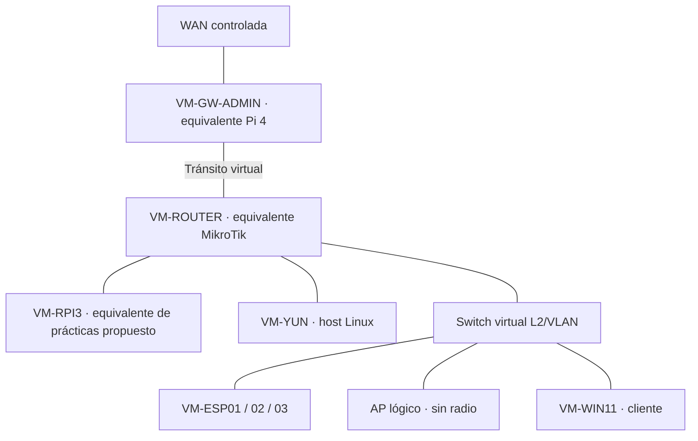

# Lenovo ThinkPad L13 Gen 3 — laboratorio virtual principal

**AVISO: diseño de réplica reproducido a continuación = HISTÓRICO (10/10/2026), sustituido por decisión del 15/10/2026.** No ejecutar su antigua secuencia de creación como plan vigente.

**Fuente de diseño conservada:** `INFORME_ARQUITECTURA_LABORATORIO_VIRTUAL`, 10/10/2026, aportado por el usuario. El diseño es una **arquitectura objetivo**, no una implementación íntegra verificada.

## Objetivo

Reproducir **funcional y lógicamente** la topología física para experimentar y comparar pruebas sin modificar equipos reales.



**Propuesta de ajuste documental del 10/10/2026:** reflejar Pi 3 y Yún como ramas LAN del router, y los clientes del switch como ramas de este. VM-RPI3 se propone para representar la estación de prácticas; no consta aprobada ni creada. VM-WIN11 sigue siendo el cliente previsto en el informe: no se demuestra que corresponda al portátil físico añadido ni se presupone su sistema operativo.

El router y el switch virtual deben compartir el segmento LAN que se decida; los enlaces del esquema expresan el objetivo funcional, no interfaces ya asignadas.

**Diferencia de alcance:** ni PoE, ni radio/SSID reales, ni las funciones de microcontrolador ESP32/Yún se reproducen mediante una VM Linux genérica.

## Preparación verificada en el informe

| Elemento | Estado en fase documentada |
|---|---|
| Host | Linux Mint 22.3; KVM/QEMU y libvirt operativos |
| SSD externo | `LAB-VMS`, ext4 en `/mnt/lab-vms`, montaje persistente |
| Pool libvirt | `lab-vms` activo, autostart |
| Red `default` | NAT+DHCP, 192.168.122.0/24 |
| Red `LAB-NET` | Activa/autostart, `virbr50`, IP host 192.168.50.1/24; sin NAT ni DHCP declarados |
| VMs de réplica | Aún no creadas en la fase descrita |

La IP de `virbr50` hace que **LAB-NET no sea absolutamente aislada del host** por el simple hecho de no tener NAT. Su rol definitivo exige decisión.

## Componentes y decisiones pendientes

| Componente objetivo | Alternativa prevista | Estado |
|---|---|---|
| VM-GW-ADMIN | Linux, 2 NICs, administración | Diseñar y crear |
| VM-ROUTER | RouterOS CHR / Debian / OpenWrt | Elegir |
| Switch L2/VLAN | Linux bridge VLAN-aware / Open vSwitch | Elegir |
| VM-YUN | Linux ligero, rama LAN del router | Crear |
| VM-RPI3 | Linux ligero para prácticas | Propuesto el 10/10; decidir y dimensionar |
| VM-ESP01/02/03 | Tres Linux ligeros | Crear |
| AP virtual | Segmento lógico, sin radio real | Diseñar |
| VM-WIN11 | Windows 11 cliente gráfico | Crear |
| Redes/VLAN | WAN, tránsito, LAN, VLAN | Definir topología y direcciones |

**No reutilizar los rangos físicos si habrá rutas que solapen ambas redes.** La salida a Internet ha de ser explícita y controlada. No conectar bridges directamente a la LAN doméstica ni intervenir Docker, Tailscale o producción.

## Secuencia documental prevista

1. Verificar estado del host y XML de `LAB-NET`; decidir su destino.
2. Elegir router y switch virtual, topología WAN/tránsito/LAN y políticas.
3. Dimensionar CPU, RAM y discos, atendiendo a la RAM de 16 GB registrada en el informe.
4. Crear gateway y router; probar tránsito.
5. Crear switching L2/VLAN y hosts; medir ARP/ICMP/DHCP.
6. Crear Windows 11 y AP lógico; comparar prácticas con laboratorio físico.
7. No plantear integración híbrida hasta validar ambos entornos por separado.

**No ejecutado:** este documento solo corrige y conserva el diseño.


---

## Diseño ACTUAL — PYME virtual conectable al laboratorio físico (decisión 15/10/2026)

**Objetivo distinto del anterior:** no reproducir Pi4/MikroTik/ESP32/Yún como VMs; crear clientes y servidores virtuales equivalentes a **nuevos equipos de una pequeña empresa** y, más adelante, conectarlos al switch SG2210P de forma controlada.

```text
Lenovo Linux Mint / KVM-QEMU
  ├── Linux Bridge PYME (nombre por definir; inicialmente aislado)
  │     ├── Windows 11 VM — estación de trabajo
  │     ├── OpenMediaVault VM — NAS/SMB/RAID de prácticas
  │     └── CUPS/IPP — contenedor Docker de prueba aislado y enlazado expresamente
  └── (futuro, NO CONECTADO) adaptador USB 3.0 a Ethernet → SG2210P
```

**Funciones:** Windows 11 para cliente SMB, DNS, IP, gestión e impresión. OpenMediaVault como servidor sin escritorio, SMB y **cuatro discos virtuales** con experimentos de RAID 0, 1, 5 y 10, usando configuraciones sucesivas para no interferir entre pruebas; los discos son simulados sobre almacenamiento existente, **no cuatro discos físicos independientes**. CUPS sirve como impresora virtual IPP sin adquirir hardware, aislado de los contenedores del Lenovo.

**Recursos previstos, NO medidos:** Windows 11 ~4 GiB RAM; OpenMediaVault ~1–2 GiB; CUPS ~100–200 MiB; sobrecarga KVM/host adicional. Estimación conjunta ~5,5–6,5 GiB adicionales, orientativa. El SSD externo `LAB-VMS` y pool `lab-vms` constaban preparados históricamente; verificar espacio libre real, RAM, CPU y estado actual antes de crear nada. **Dependencia previa:** migración controlada de Omada a VPS para liberar recursos sin interrumpir gestión.

**Red y direcciones:** primero switch virtual Linux Bridge en segmento privado de prueba aún no elegido. Más adelante conectar por USB-Ethernet propio del Lenovo al SG2210P, con puerto/VLAN validados y autorización. Propuestas `192.168.88.110` (Windows), `192.168.88.120` (OMV) y `192.168.88.130` (CUPS): **no son concesiones ni reservas**. Confirmar que no hay conflictos con MikroTik DHCP/NetBox; no usar bridge sobre interfaz Wi-Fi cliente y no apropiarse del RTL8153 del MEDION, que sirve a OPNsense VLAN20.

**Secuencia nueva:** (1) comprobar/migrar Omada con backup y rollback, (2) medir recursos del Lenovo, (3) inspeccionar libvirt y crear red aislada, (4) crear Windows 11, (5) crear OMV + discos y SMB, (6) conectar CUPS/IPP de pruebas, (7) tras verificar rutas/firewall/segmentación, autorizar enlace Ethernet al físico, (8) documentar capturas/mediciones y NetBox. **Estado: PLANIFICADO, sin VMs nuevas ni red conectada.**

La plataforma MEDION `netlab-ws01` no forma parte de esta PYME salvo decisión posterior explícita.


## Estado posterior: bridge `br-pyme` operativo (15/10/2026)

**Actualiza el diseño anterior:** el bridge del anfitrión **ya está conectado a la LAN física**, no está aislado. Se creó mediante NetworkManager con UUID `20409153-bc7e-44e3-95e5-4fe172dae4fd`, STP activado, VLAN filtering desactivado e IPv4 por DHCP. Puerto subordinado: USB-Ethernet `enx00e04c6808a2` conectado al SG2210P; la dirección IPv4 reside en `br-pyme`, no en la NIC subordinada.

- **IPv4 DHCP del bridge:** `192.168.88.236/24` (dinámica). MikroTik: `192.168.88.1`.
- **Salida IPv4 predeterminada del Lenovo:** Wi-Fi Starlink `wlp0s20f3`, `192.168.1.192/24`, gateway `192.168.1.1`. La ruta default temporal a través de MikroTik se corrigió con `ipv4.never-default yes` y `nmcli device reapply br-pyme`.
- **Prueba verificada en la sesión:** `ping -c 4 -I br-pyme 192.168.88.1` → 4/4 respuestas, 0 % pérdidas; RTT mínimo/medio/máximo: 0,453/0,594/0,784 ms.
- **Libvirt:** `default` y `LAB-NET` activas y autostart; `virsh list --all` sin ninguna VM. Docker preservado.
- **Omada:** continúa en Lenovo. Consumo observado del servicio ~3,9 GB RAM y 234,1 MB swap; migración VPS aún pendiente.

**Precaución:** no hay prueba de conectividad de VM ni aislamiento VLAN. Windows 11/OMV y CUPS siguen pendientes; conectar VMs al bridge las expondría al dominio L2 del laboratorio físico. Comprobar políticas de red y direccionamiento antes. MEDION es independiente. Persistencia tras reinicio no contrastada.
